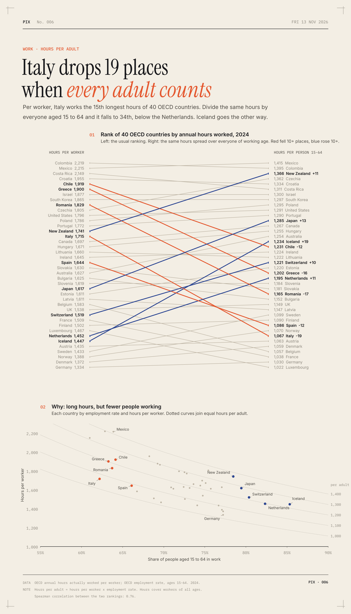

**pix** · one visual analysis of the world, every day · No. 6 · 2026-11-13 · Work · [archive →](archive/)

# Italy drops 19 places when every adult counts

The usual league table of working hours divides total hours by the number of people in work. That answers how hard the employed work. It says nothing about how many people are employed, which is the bigger difference between rich countries.

So I divided the same hours by everyone aged 15 to 64 instead, for the 40 OECD countries with 2024 data, and re-ranked them.

- Italy goes from 15th to 34th. Its workers put in 1,715 hours a year, but only 62.2% of working-age Italians have a job, so it comes to 1,067 hours per adult.
- The Netherlands goes the other way: 1,452 hours per worker, 1,195 per adult. Italians work 263 more hours per worker and 128 fewer per adult. That's 20.5 hours a week against 23.0.
- Iceland rises 19 places (35th to 16th) on an 85.3% employment rate. Japan rises 13.
- Greece falls 16 places and Romania 17. Germany stays near the bottom either way (40th, then 39th).
- 10 of the 40 countries move 10 places or more. The rank correlation between the two tables is 0.76.

Long hours per worker often go with a small workforce. In Italy, Greece and Spain, the famous long hours say as much about who isn't working as about who is.

**How I did it.** Annual hours actually worked per worker and the employment rate for ages 15 to 64 both come from the OECD, for 2024. Hours per adult is one times the other. The hours figure covers workers of every age while the employment rate stops at 64, so this is an approximation, but the ranking holds with 2023 data too (Italy goes from 15th to 37th). The OECD says its hours series is built for comparing trends, not levels, so treat neighbouring ranks as ties and look at the big moves.

[Code](archive/2026-11-13-hours-per-adult/analysis.py) · [Data](archive/2026-11-13-hours-per-adult/data/) · [SVG](archive/2026-11-13-hours-per-adult/chart.svg)

---

Previously: [Most people alive were born after the Berlin Wall fell](archive/2026-11-12-born-after-the-wall/post.md) · [The world's clocks run fast](archive/2026-11-11-clocks-run-fast/post.md) · [Two in five city dwellers live closer to a foreign capital](archive/2026-11-10-closer-to-a-foreign-capital/post.md) · [full archive](archive/) · [how this works](CLAUDE.md)
