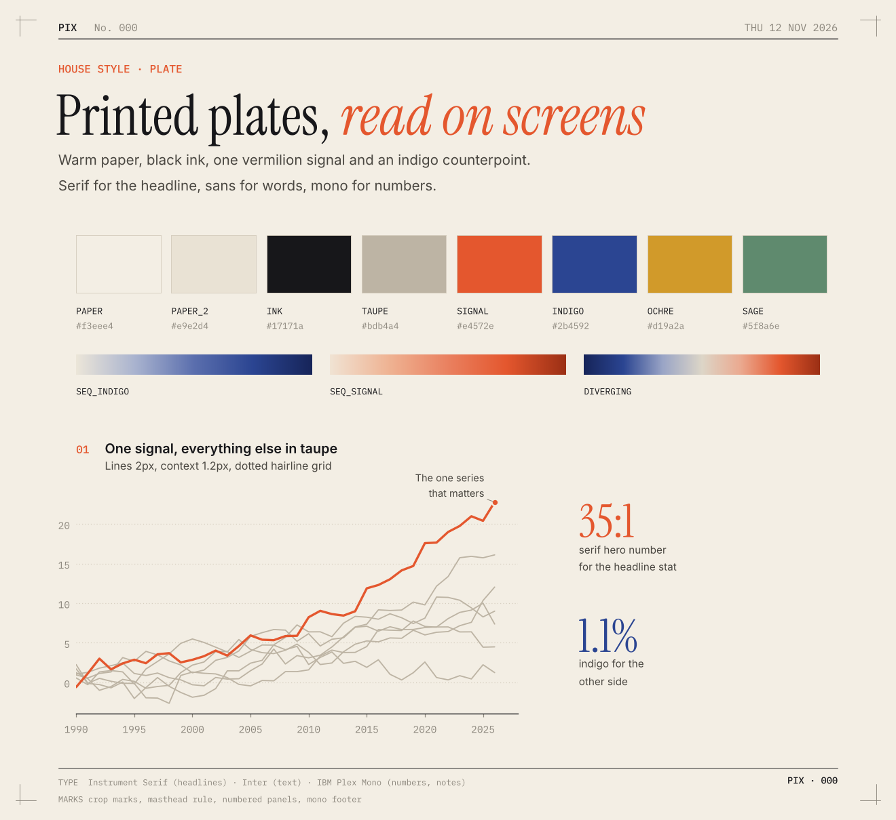

# pix house style: Plate

Every pix graphic is a **printed plate read on a screen**: warm paper, black ink, one vermilion
signal, crop marks in the corners. The look borrows from old almanacs, scientific plates and
Swiss print, set with modern type and very little decoration. It should look like nothing
else in a feed, and still look right in 20 years.

The code lives in `pix/style.py` (`from pix import style as px`). Fonts are bundled in
`pix/fonts/` (all OFL licensed), so the look is the same on every machine.

## The parts of a plate

1. **Crop marks** in the four corners: `px.plate(width, height)`.
2. **Masthead**: `PIX  No. 007` on the left, the date on the right in mono, over a thin black rule.
   `px.masthead(fig, date, no)`, with `no = px.issue_number(__file__)`.
3. **Kicker**: a mono, vermilion, uppercase topic line ("TIME · SUN VS. CLOCK").
4. **Headline**: large Instrument Serif. Put one phrase in `*asterisks*` to set it in vermilion
   italic, ideally the words that carry the finding ("The world's clocks *run fast*"). Use it once
   per headline, or not at all.
5. **Deck**: one or two plain sentences in Inter, saying how to read the chart.
   `px.headline(...)` returns the y just below the deck, so lay out the panels from there.
6. **Numbered panels**: a vermilion mono `01`, a short sans title and a muted subtitle.
   `px.panel(ax, 1, title, subtitle)`.
7. **Footer**: a thin rule, then mono notes (`DATA ...`, `NOTE ...`) on the left and `PIX · 007`
   on the right. `px.footer(fig, text, no)`.

## Colour

| Role | Name | Hex | Use |
|---|---|---|---|
| Paper | `PAPER` | `#f3eee4` | background, always |
| Band | `PAPER_2` | `#e9e2d4` | reference bands, highlighted ranges |
| Ink | `INK` | `#17171a` | text, baselines, reference lines |
| Context | `TAUPE` | `#bdb4a4` | everything that isn't the point |
| Signal | `SIGNAL` | `#e4572e` | **the one thing to look at** |
| Counterpoint | `INDIGO` | `#2b4592` | the other side of a contrast |
| Extra | `OCHRE`, `SAGE` | `#d19a2a`, `#5f8a6e` | only when identity really needs 3 to 4 series |

- **Default to two colours: vermilion and taupe.** Add indigo only for a real contrast (early vs
  late, gain vs loss). Most plates should use one or two colours at most.
- Ramps: `SEQ_INDIGO` (magnitude), `SEQ_SIGNAL` (magnitude where intensity is the point), and
  `DIVERGING` (indigo, through warm grey, to vermilion).
- Never use a rainbow, neon, or pure white or grey backgrounds.

## Type

| Role | Font | Where |
|---|---|---|
| Headline, hero numbers | Instrument Serif | title, `px.big_number` |
| Words | Inter | deck, panel titles, labels, annotations |
| Numbers and notes | IBM Plex Mono | ticks (`px.mono_ticks(ax)`), masthead, kicker, footer |

## Marks

- Dotted hairline grid on one axis only. No boxes, no top or right spines, and no left spine.
  Keep the baseline as a solid ink hairline.
- Use 2px lines for the signal and 1 to 1.2px for context. Dots get a thin paper-coloured edge.
- Annotate directly with `px.note` (a hairline leader and a short label). Use legends only when
  direct labels truly won't fit.
- One serif hero number per panel at most (`px.big_number`).
- Never use dual axes, 3D, drop shadows, gradients as decoration, or pie charts with more than 3
  slices.

## Size

- The default plate is 12 in wide, saved at dpi 150 (1800 px). Height varies with the content,
  usually 11 to 16 in.
- Save with `px.save(fig, __file__)`, which writes `chart.png` and `chart.svg`.
- If you build an `index.html`, use the same paper, ink, fonts and colours.

## The rule

The style should be recognisable in a thumbnail: paper colour, serif headline, one vermilion
note, crop marks. Within that, every day's chart form can and should change.

Regenerate the specimen with `python scripts/specimen.py`.
