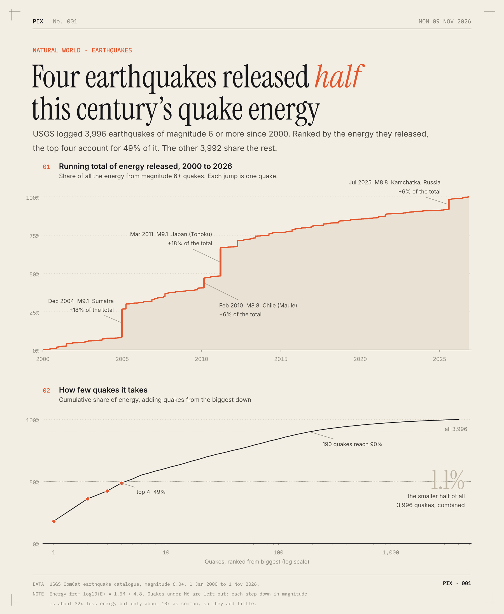

# Four earthquakes released half this century's quake energy

USGS has logged 3,996 earthquakes of magnitude 6 or more since 2000. I worked out how much energy each one released and added them up.

Four of them released 49% of it. The other 3,992 split the rest.

- Sumatra (Dec 2004) and Japan (Mar 2011) were both M9.1. Each one is 18% of the total.
- Chile (Feb 2010) and Kamchatka (Jul 2025) were M8.8. Each is 6%.
- One M9.1 releases as much energy as 44,668 quakes of M6.0.
- The 28 quakes of M8 or more add up to 72%.
- 190 quakes, under 5% of them, get you to 90%.
- The smaller half of all 3,996 quakes adds up to 1.1%.

So a normal year barely moves the total. Most of the century's quake energy came out on four days, and the next big one will move it again.

**How I did it.** The quakes come from the USGS catalogue, magnitude 6.0 and up, from January 2000 to November 2026. I turned each magnitude into energy with the standard formula (each full magnitude step is about 32 times more energy). I left out quakes under M6. They're about 10 times as common per step down but each releases 32 times less, so they wouldn't change much. Magnitude only roughly tracks energy, so treat the exact shares as approximate.

[Code](analysis.py) · [Data](data/) · [SVG](chart.svg)
