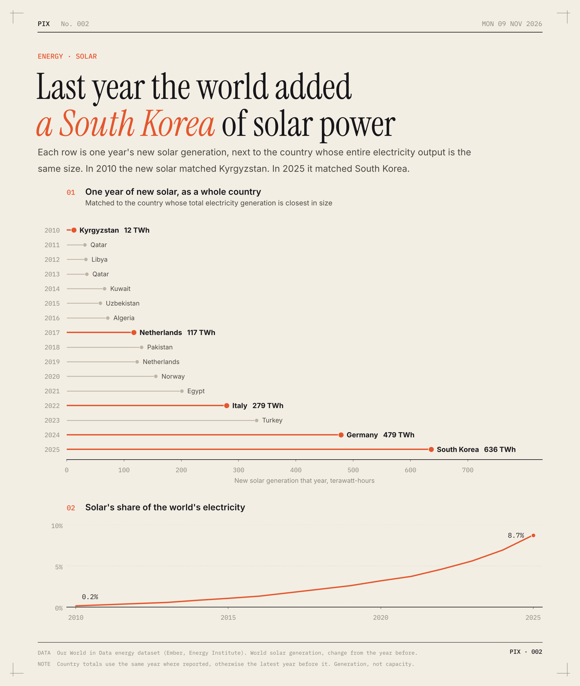

# Last year the world added a South Korea of solar power

Solar numbers are hard to picture, so I lined each year's new solar up against a whole country. For every year since 2010 I took how much more electricity the world got from solar than the year before, then found the country whose total electricity output is closest in size.

In 2010 the new solar was about the size of Kyrgyzstan. In 2025 it was about the size of South Korea.

- 2025 added 636 TWh of solar. South Korea made 625 TWh of electricity, from everything, that year.
- The ladder goes Kyrgyzstan (2010), the Netherlands (2017), Italy (2022), Germany (2024), South Korea (2025).
- Last year's new solar was 11 times what was added in 2015.
- Solar went from 0.2% of the world's electricity in 2010 to 8.7% in 2025.
- World electricity output grew by 842 TWh in 2025. New solar covered 76% of that growth.

So most of the extra electricity the world uses each year now comes from solar.

**How I did it.** The numbers are from Our World in Data's energy dataset, which uses Ember and the Energy Institute. New solar is world solar generation minus the year before. I compared it to each country's total generation in the same year, or the latest year before it where that isn't reported yet. This is electricity actually generated, not panels installed, so it already counts cloudy years and curtailment.

[Code](analysis.py) · [Data](data/) · [SVG](chart.svg)
