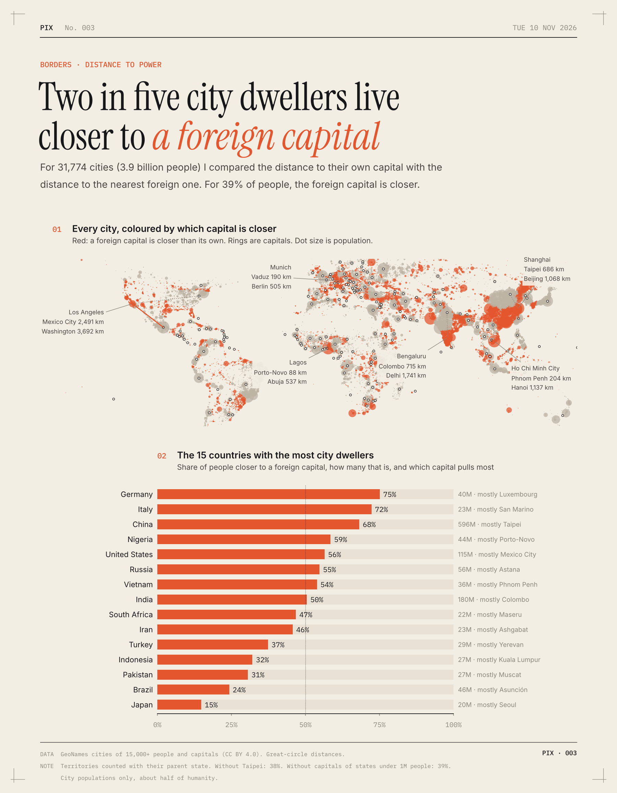

# Two in five city dwellers live closer to a foreign capital

I took every city with at least 15,000 people (31,774 cities, 3.9 billion people) and measured two distances: to its own capital, and to the nearest capital of any other country.

For 39% of people, the foreign one is closer. That's 1.5 billion people, or about 1 in 2.5.

- China is 68%. Shanghai is 686 km from Taipei and 1,068 km from Beijing.
- In the US it's 56%, mostly Mexico City. Los Angeles is 2,491 km from Mexico City and 3,692 km from Washington.
- Half of India's city dwellers are closer to Colombo, Dhaka or Kathmandu. Bengaluru is 715 km from Colombo and 1,741 km from Delhi.
- Lagos is 88 km from Porto-Novo, Benin's capital. Abuja is 537 km away.
- Germany (75%) and Italy (72%) are high because of tiny neighbours like Luxembourg and San Marino.
- Japan is lowest of the 15 biggest countries, at 15%.

Leave China out and it's still 31%. My guess at why: capitals often sit off-centre, so big countries end up with lots of people on the far side, and those people often live near a border.

**How I did it.** Cities and capitals are from GeoNames. Distances are straight-line, over the globe. Territories count with their parent country, so Hong Kong is China and its capital isn't foreign. Counting Taipei as a foreign capital is a judgment call: drop it and the share is 38%. Ignore capitals of countries under 1 million people and it's 39%. Drop both and it's 37%. This only covers people in cities, about half the world.

[Code](analysis.py) · [Data](data/) · [SVG](chart.svg)
