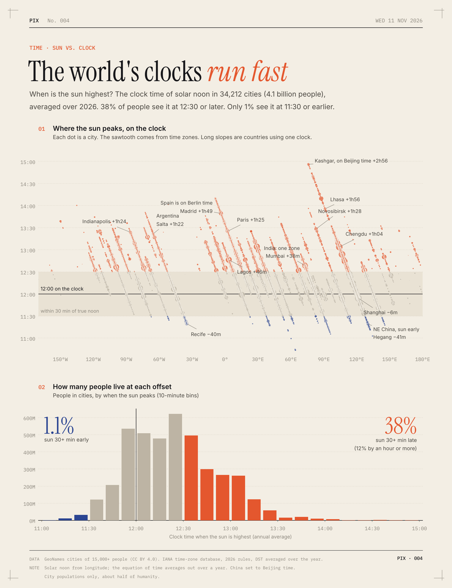

# The world's clocks run fast

You'd expect the sun to be highest around noon. For most people it's later than that, and it's almost never earlier.

I took every city with at least 15,000 people (34,212 cities, 4.1 billion people) and worked out what the clock says when the sun is highest, averaged over 2026.

- 38% of people see the sun peak at 12:30 or later. Only 1.1% see it at 11:30 or earlier.
- On average the sun peaks 24 minutes after noon.
- Daylight saving is only part of it. On standard time alone, 27.5% are still 30+ minutes late.
- Spain is the furthest off. Its sun peaks at 1:43pm on average, and close to 2pm in Seville. Most of Spain is west of London, but it's been on Central European Time since 1940.
- China uses one time zone for the whole country. The sun peaks near 3pm in Kashgar and at 11:19am in Hegang, way up in the northeast.
- The few places where the sun comes early are Brazil's northeast coast, the eastern edges of India's and Indonesia's time zones, and northeast China.

When countries choose a time zone, they push the clock ahead. That buys more light in the evening and costs light in the morning. Almost nobody goes the other way.

**How I did it.** Solar noon comes from each city's longitude. Time zone offsets come from the IANA tz database for every day of 2026, so daylight saving counts for the months it's on. City populations are from GeoNames, so this covers people in cities only, about half the world. China is set to Beijing time everywhere, though a lot of people in Xinjiang unofficially use a clock two hours behind.

[Code](analysis.py) · [Data](data/) · [SVG](chart.svg)
