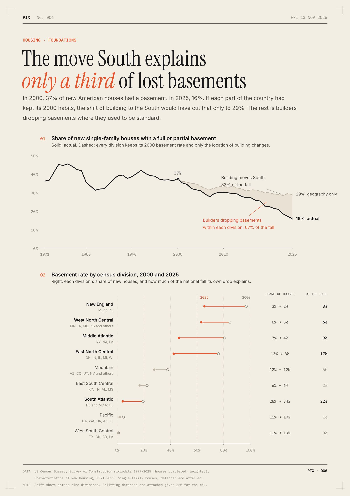

# The move South explains only a third of lost basements

In 2000, 37% of new single-family houses in the US had a full or partial basement. In 2025 it was 16%. The obvious explanation is geography: more houses go up in Texas, Florida and the Carolinas, where hardly anyone digs one.

I split the change in two across the nine census divisions: the shift in where houses are built, and the change in how often each division builds a basement. Geography accounts for a third. The rest is builders dropping basements where they used to be standard.

- If every division had kept its 2000 basement rate, the national share would have fallen only to 29%, not 16%.
- The South's share of new houses rose from 45.5% to 58.2%. Together with the North shrinking, that shift is worth 7.1 of the 21.5 points lost.
- East North Central (Ohio to Wisconsin) went from 76% to 42%, and the Middle Atlantic from 81% to 46%. Builders in the four northern divisions account for 36% of the national fall on their own, more than the move South.
- The biggest single contributor is the South Atlantic, where the rate fell from 19% to 4%.

Most lost basements were lost in place, including where the ground freezes. My guess, and it is only a guess, is cost: the basement is the biggest item a builder can cut from a house priced to the limit.

**How I did it.** Census Survey of Construction microdata, houses completed in 2000 and 2025 (19,918 and 13,440 sampled), weighted. A shift-share decomposition with average weights, so the two parts add up exactly. Splitting detached from attached houses gives 36% for composition, a 1999 start gives 33%, and so does the published four-region table from the 1975 peak. A shift inside a division (Virginia to Florida, say) counts as "within", so a third is a floor for geography. NAHB's yearly foundation posts track the national trend; I haven't seen it split this way.

[Code](analysis.py) · [Data](data/) · [SVG](chart.svg)
