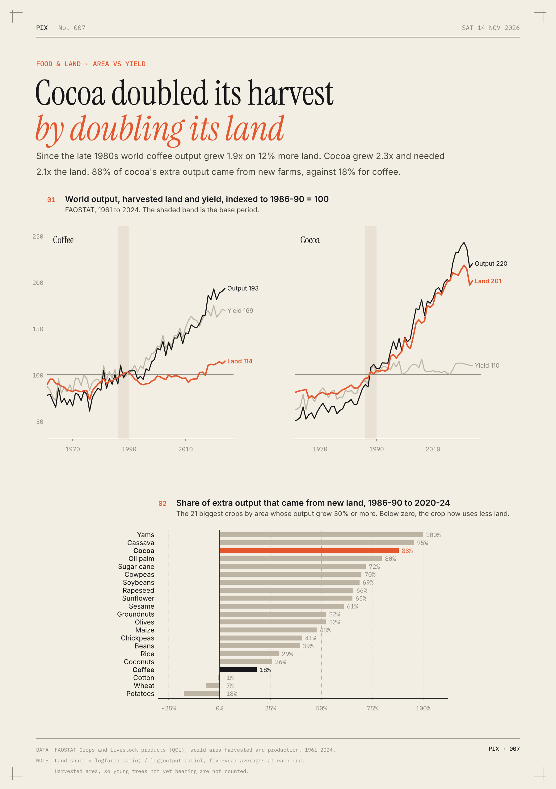

# Cocoa doubled its harvest by doubling its land

Coffee and cocoa have a lot in common: tropical trees, mostly smallholders, sold into global commodity markets. Both roughly doubled their world output between the late 1980s and the early 2020s. They got there in opposite ways.

I split each crop's growth into more land and more output per hectare, using FAOSTAT area and production with five-year averages at each end.

- Coffee output grew 1.89x on only 1.12x the land. Yields went from 0.54 to 0.90 tonnes per hectare, so 18% of the growth came from new land.
- Cocoa output grew 2.30x and harvested area grew 2.08x, from 5.48 to 11.42 million hectares. Yields barely moved (0.43 to 0.48), so 88% of the growth came from new land.
- Brazil added 1.80 million tonnes of coffee while its coffee area shrank by 0.98 million hectares. Vietnam's yields went from 1.26 to 2.90 tonnes per hectare.
- Côte d'Ivoire alone added 2.78 million hectares of cocoa, 47% of the world's extra cocoa land, at flat yields (0.53 to 0.51).
- If cocoa yields had grown as fast as coffee's, today's crop would fit on 7.51 million hectares instead of 11.42.

Among the 21 biggest crops by area, cocoa ranks third for reliance on new land, behind only yams and cassava. Coffee ranks 18th. My guess is that much of the 5.94 million extra hectares used to be forest, but this data can't show that.

**How I did it.** FAOSTAT's crops data (QCL) gives world harvested area and production for 1961 to 2024. Production is area times yield, so the land share of growth is the log of the area ratio over the log of the output ratio. Starting from 1991-95 instead gives 29% for coffee and 94% for cocoa. Harvested area leaves out young trees that aren't bearing yet, which if anything understates cocoa's land.

[Code](analysis.py) · [Data](data/) · [SVG](chart.svg)
