# pix archive

10 settled findings, newest first. Each folder holds the post, the chart, the evidence notes, the code and the data.

| Date | | Finding |
|---|---|---|
| 2026-11-27 | <a href="2026-11-27-solar-learning-curve/post.md">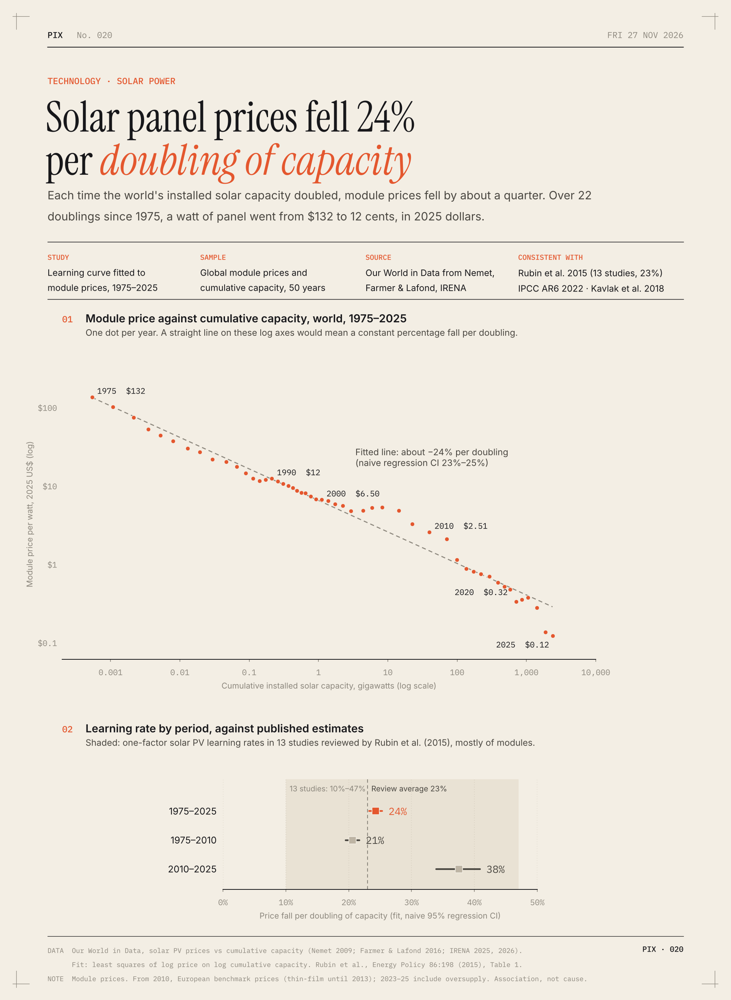</a> | **[Solar panel prices fell 24% per doubling of capacity](2026-11-27-solar-learning-curve/post.md)** Technology · Rubin et al., Energy Policy, 2015; data from Our World in Data (Nemet; Farmer & Lafond; IRENA) Each doubling of the world's installed solar capacity came with a 24% fall in module prices. Since 1975 a watt of panel went from $132 to 12 cents, in 2025 dollars. |
| 2026-11-26 | <a href="2026-11-26-bmi-mortality-age/post.md">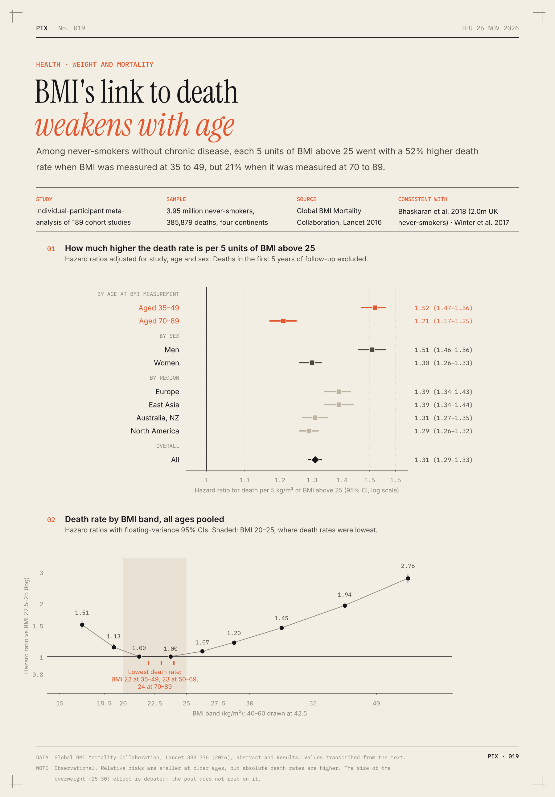</a> | **[BMI's link to death weakens with age](2026-11-26-bmi-mortality-age/post.md)** Health · Global BMI Mortality Collaboration, Lancet, 2016 In never-smokers, each 5 units of BMI above 25 went with a 52% higher death rate when BMI was measured at 35 to 49, but 21% when measured at 70 to 89. |
| 2026-11-25 | <a href="2026-11-25-lead-iq-low-levels/post.md">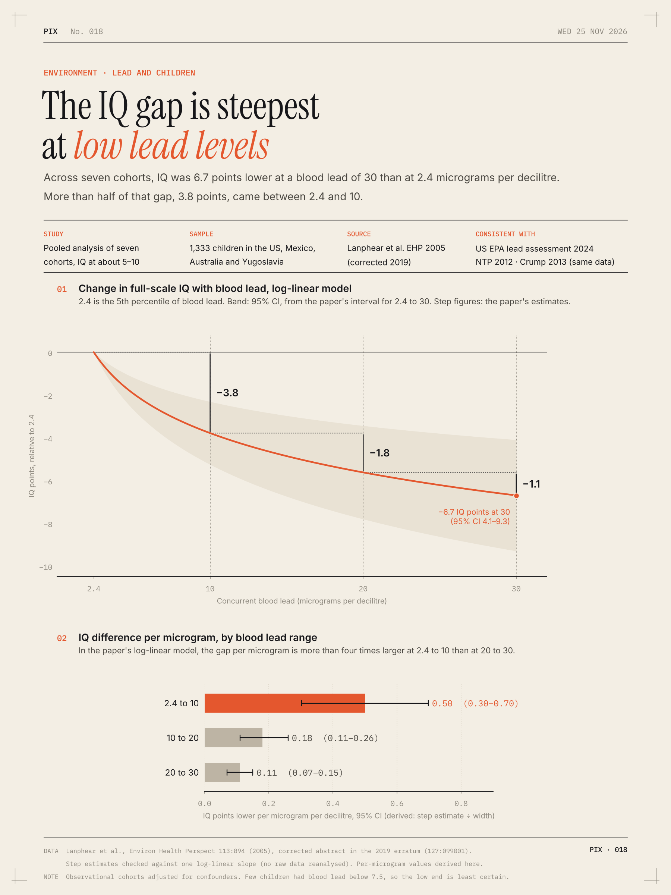</a> | **[The IQ gap is steepest at low lead levels](2026-11-25-lead-iq-low-levels/post.md)** Environment · Lanphear et al., Environmental Health Perspectives, 2005 (corrected 2019) In 1,333 children, IQ was 6.7 points lower at a blood lead of 30 micrograms per decilitre than at 2.4. More than half of that, 3.8 points, came between 2.4 and 10. |
| 2026-11-24 | <a href="2026-11-24-youngest-in-class-adhd/post.md">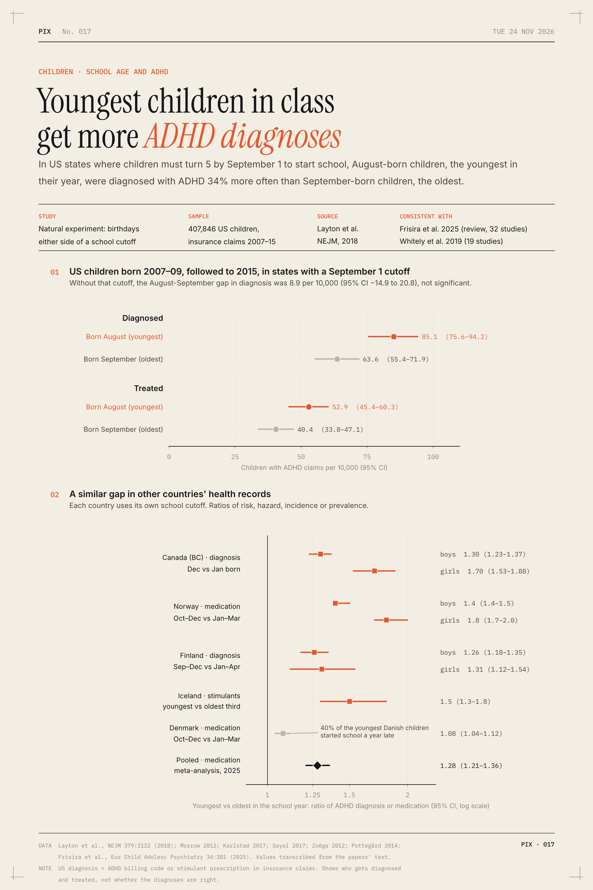</a> | **[Youngest children in class get more ADHD diagnoses](2026-11-24-youngest-in-class-adhd/post.md)** Children · Layton et al., New England Journal of Medicine, 2018 In US states with a September 1 school cutoff, August-born children were diagnosed with ADHD 34% more often than September-born children, 85.1 against 63.6 per 10,000. |
| 2026-11-23 | <a href="2026-11-23-quit-smoking-age/post.md">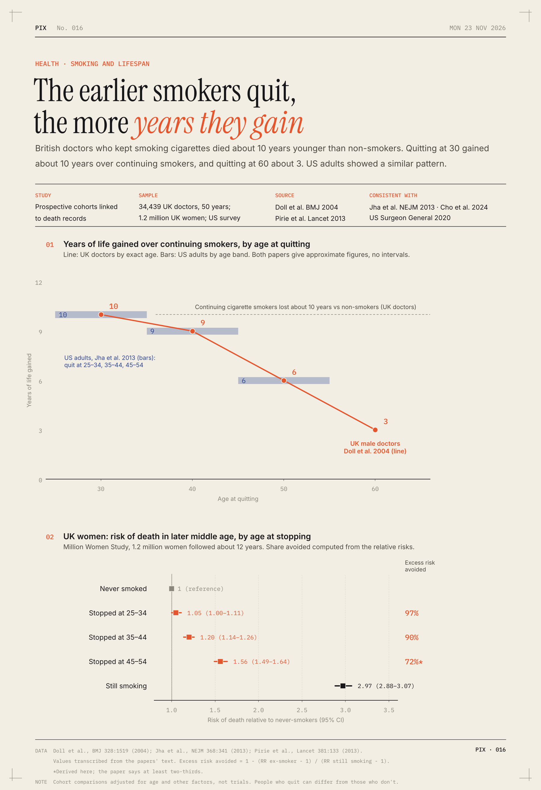</a> | **[The earlier smokers quit, the more years they gain](2026-11-23-quit-smoking-age/post.md)** Health · Doll et al., BMJ, 2004 British doctors who quit smoking at 30 gained about 10 years of life over those who kept smoking. Quitting at 60 gained about 3. |
| 2026-11-22 | <a href="2026-11-22-warming-cumulative-co2/post.md">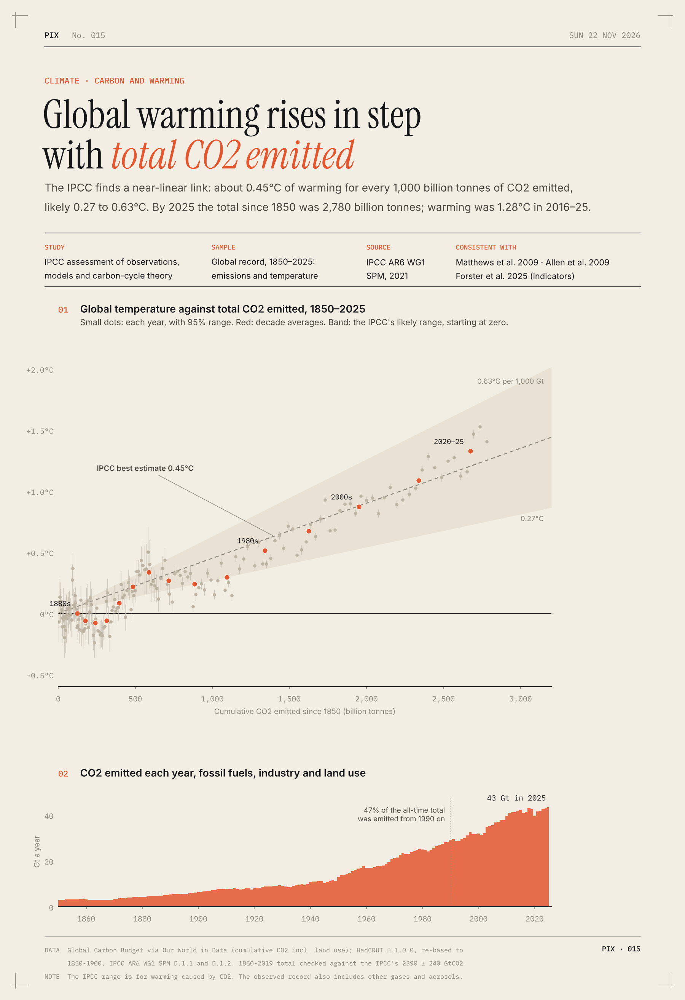</a> | **[Global warming rises in step with total CO2 emitted](2026-11-22-warming-cumulative-co2/post.md)** Climate · IPCC, AR6 Working Group I Summary for Policymakers, 2021 The IPCC finds about 0.45°C of warming per 1,000 billion tonnes of CO2 emitted. The total since 1850 reached 2,780 billion tonnes by 2025. |
| 2026-11-21 | <a href="2026-11-21-income-life-expectancy/post.md">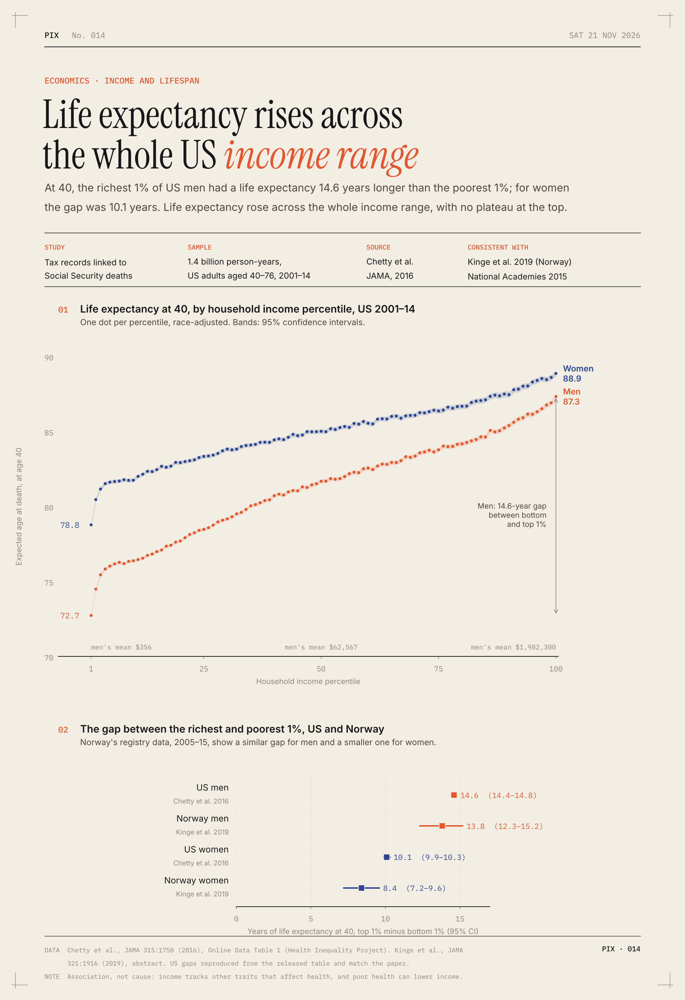</a> | **[Life expectancy rises across the whole US income range](2026-11-21-income-life-expectancy/post.md)** Economics · Chetty et al., JAMA, 2016 In 2001-14, US men in the top 1% of income had a life expectancy at 40 that was 14.6 years longer than the bottom 1%. For women the gap was 10.1 years. |
| 2026-11-20 | <a href="2026-11-20-outdoor-time-myopia/post.md">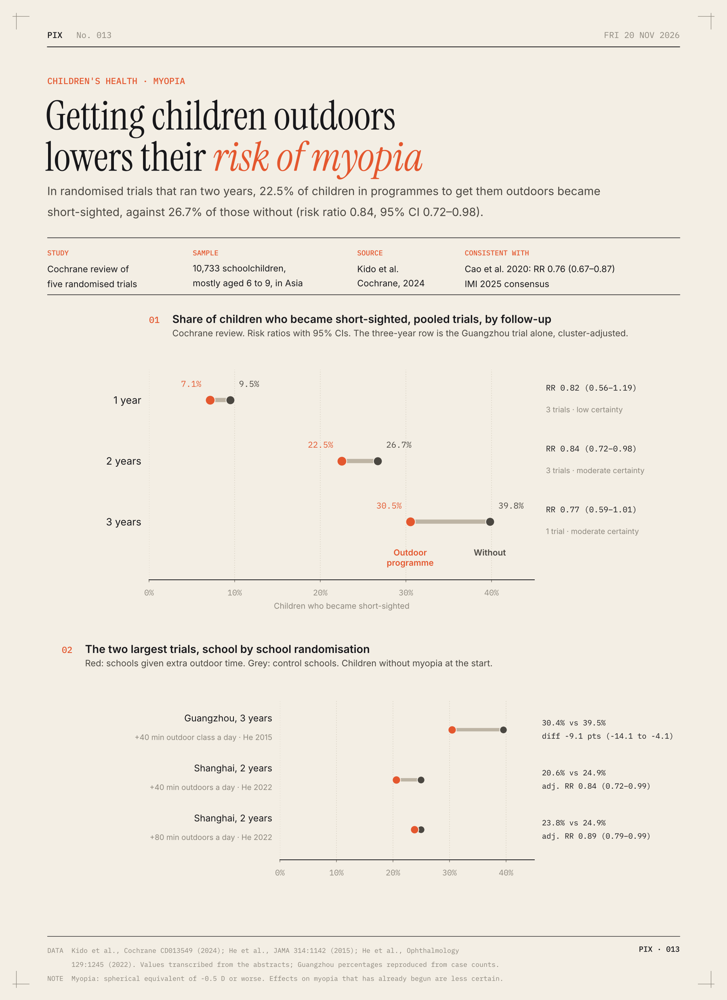</a> | **[Getting children outdoors lowers their risk of myopia](2026-11-20-outdoor-time-myopia/post.md)** Children's health · Kido et al., Cochrane Database of Systematic Reviews, 2024 In trials that ran two years, 22.5% of children in programmes to get them outdoors became short-sighted, against 26.7% without. |
| 2026-11-19 | <a href="2026-11-19-pedestrian-speed-risk/post.md">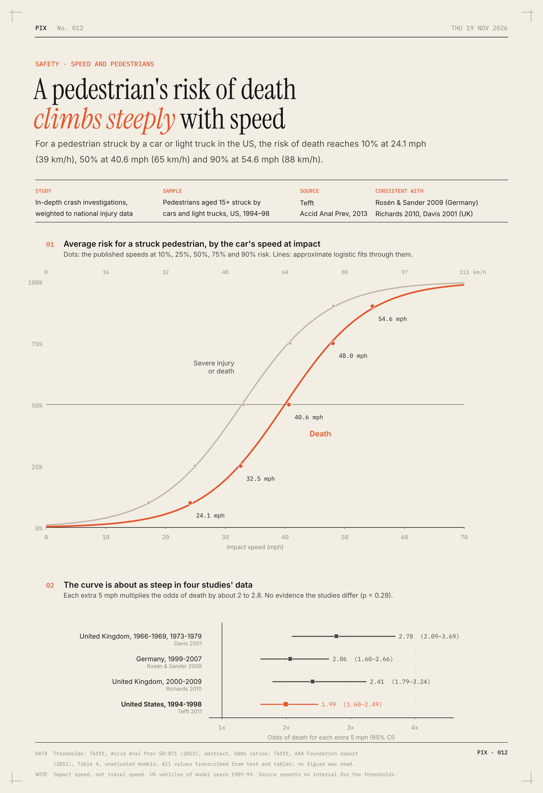</a> | **[A pedestrian's risk of death climbs steeply with speed](2026-11-19-pedestrian-speed-risk/post.md)** Safety · Tefft, Accident Analysis & Prevention, 2013 A struck pedestrian's risk of death reaches 10% at 24.1 mph, 50% at 40.6 mph and 90% at 54.6 mph. Each extra 5 mph multiplies the odds by about 2 to 2.8. |
| 2026-11-18 |  | **[Older fathers pass on more new mutations](2026-11-18-older-fathers-new-mutations/post.md)** Genetics · Jónsson et al., Nature, 2017 Each year of a father's age at conception adds 1.51 new mutations to his child's genome. Each year of the mother's adds 0.37. |

## Earlier series

The first ten entries looked for new patterns in public data rather than charting settled findings. They are kept for the record.

| Date | | Analysis |
|---|---|---|
| 2026-11-17 |  | **[Israel is outgrowing its immigrants](2026-11-17-israel-outgrows-immigrants/post.md)** Migration The foreign-born share rose in 43 of 51 rich countries since 1990. Israel's fell the most, from 36% to 22%, even though 29% more immigrants live there now. |
| 2026-11-16 |  | **[Satellites stopped shrinking in 2017](2026-11-16-satellites-heavier-again/post.md)** Space The median satellite fell from about 1,450 kg to 5 kg by 2017 as CubeSats took over. It has since climbed back to 575 kg, and to 267 kg even without Starlink. |
| 2026-11-15 | <a href="2026-11-15-big-tech-long-cables/post.md">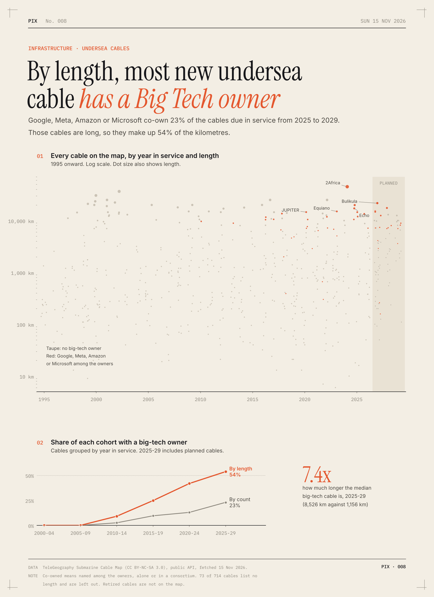</a> | **[By length, most new undersea cable has a Big Tech owner](2026-11-15-big-tech-long-cables/post.md)** Infrastructure Google, Meta, Amazon or Microsoft co-own 23% of the undersea cables due in service from 2025 to 2029, but 54% of the kilometres. Their cables are the long ones. |
| 2026-11-14 | <a href="2026-11-14-cocoa-needs-new-land/post.md">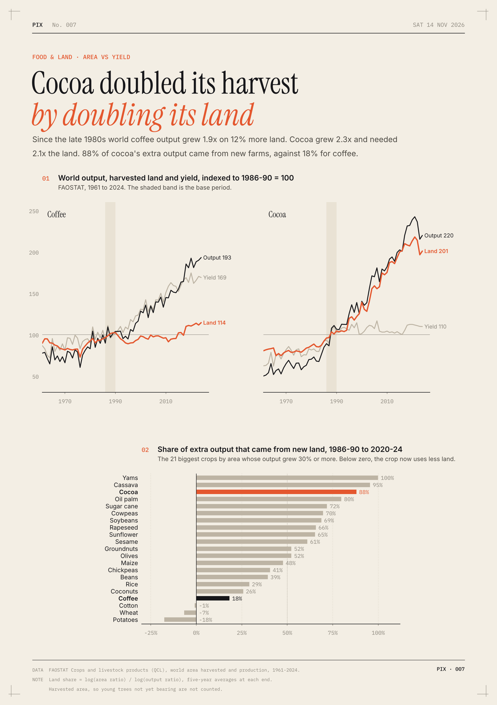</a> | **[Cocoa doubled its harvest by doubling its land](2026-11-14-cocoa-needs-new-land/post.md)** Food & land Since the late 1980s, 88% of the growth in world cocoa output came from new land. For coffee, the other big tropical tree crop, it was 18%. |
| 2026-11-13 | <a href="2026-11-13-basements-vanish-in-place/post.md">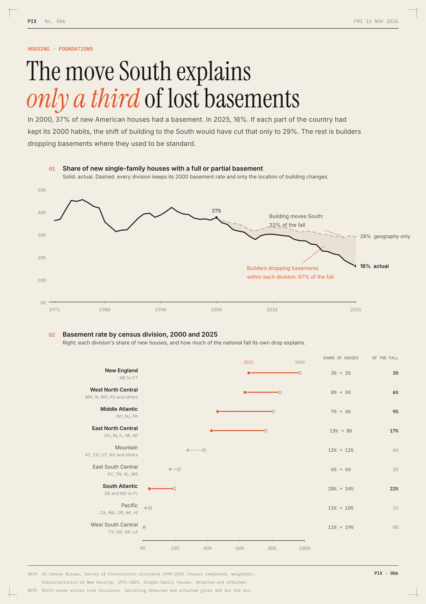</a> | **[The move South explains only a third of lost basements](2026-11-13-basements-vanish-in-place/post.md)** Housing New US houses with a basement fell from 37% in 2000 to 16% in 2025. Building shifting South accounts for a third of that. Builders dropping basements in places that had them account for the rest. |
| 2026-11-12 | <a href="2026-11-12-born-after-the-wall/post.md">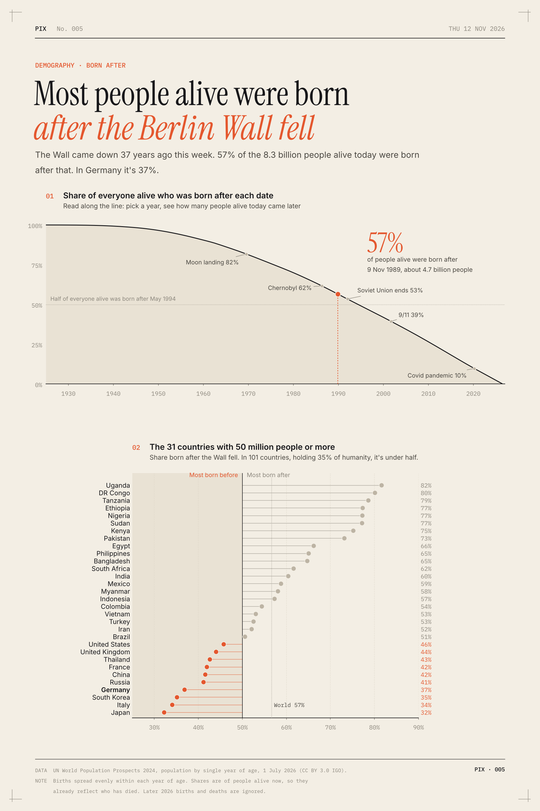</a> | **[Most people alive were born after the Berlin Wall fell](2026-11-12-born-after-the-wall/post.md)** Demography 57% of the 8.3 billion people alive today were born after 9 November 1989. In Germany it's 37%, and in 101 countries it's under half. |
| 2026-11-11 |  | **[The world's clocks run fast](2026-11-11-clocks-run-fast/post.md)** Time For most people the sun peaks after noon, not at it. 38% see it at 12:30 or later. Only 1% see it at 11:30 or earlier. |
| 2026-11-10 | <a href="2026-11-10-closer-to-a-foreign-capital/post.md">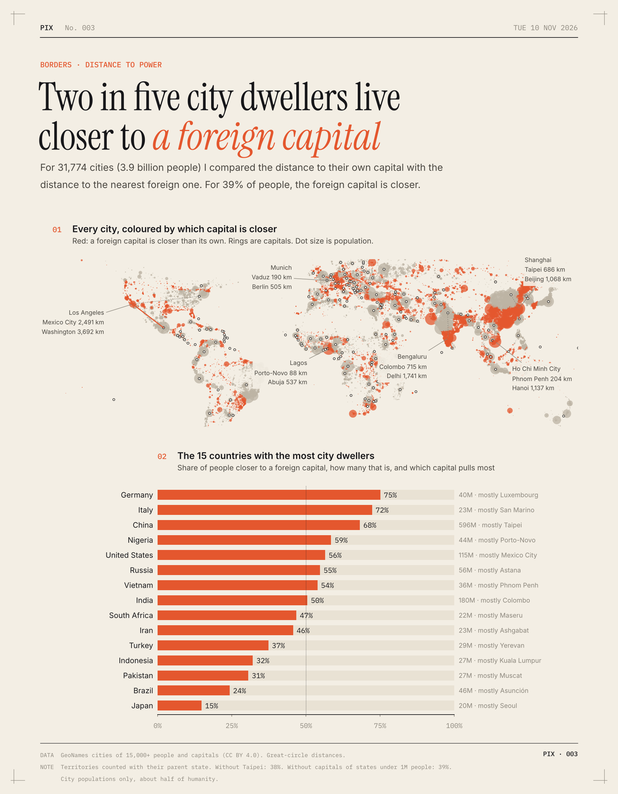</a> | **[Two in five city dwellers live closer to a foreign capital](2026-11-10-closer-to-a-foreign-capital/post.md)** Borders For 39% of people in cities, some other country's capital is closer than their own. In China it's 68%, mostly because of Taipei. |
| 2026-11-09 | <a href="2026-11-09-solar-adds-a-country/post.md">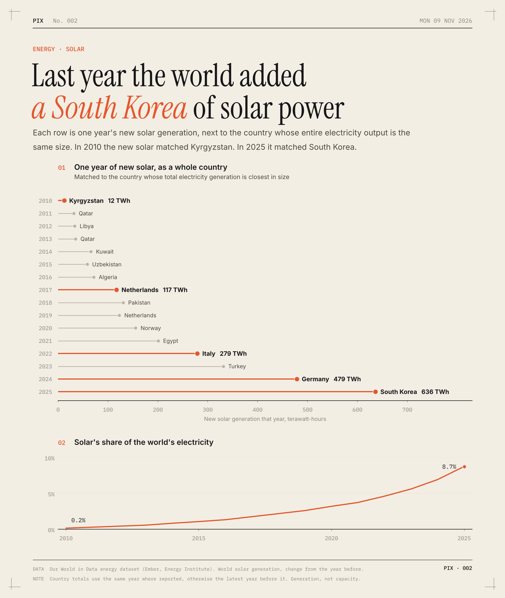</a> | **[Last year the world added a South Korea of solar power](2026-11-09-solar-adds-a-country/post.md)** Energy New solar in 2025 made 636 TWh, about as much as South Korea's entire electricity output. In 2010 the new solar matched Kyrgyzstan. |
| 2026-11-08 |  | **[Four earthquakes released half this century's quake energy](2026-11-08-quake-energy/post.md)** Natural world Of 3,996 magnitude 6+ quakes since 2000, the top four released 49% of the energy. The smaller half of all those quakes released 1.1%. |
