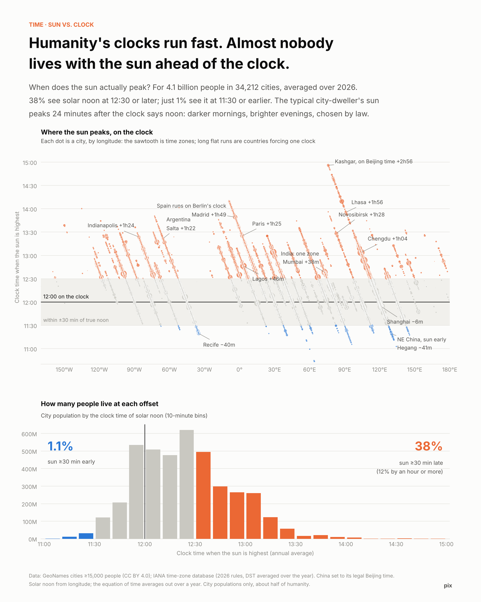

# pix archive

1 visual analyses, newest first. Each folder holds the post, the chart, the code and the data.

| Date | | Analysis |
|---|---|---|
| 2026-11-12 |  | **[Humanity's clocks run fast. Almost nobody lives with the sun ahead of the clock](2026-11-12-clocks-run-fast/post.md)** Time Across 4.1bn city-dwellers, 38% see the sun peak at 12:30 or later; only 1.1% see it at 11:30 or earlier. Time zones aren't centred on the sun. They lean one way, by 35 to 1. |
