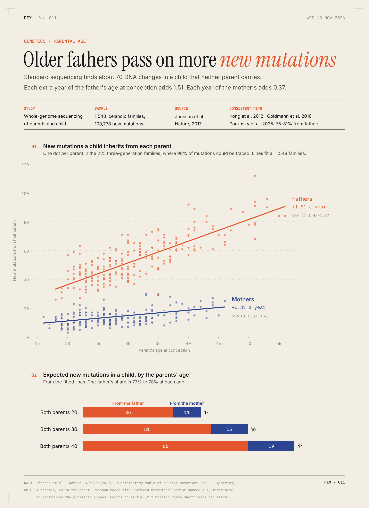
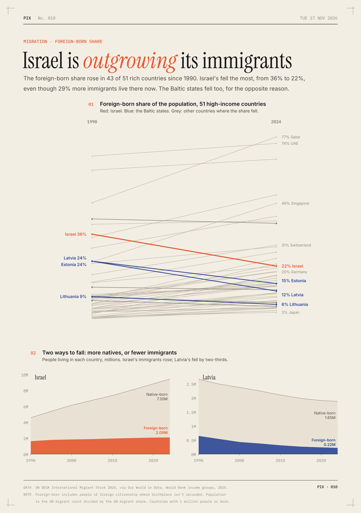
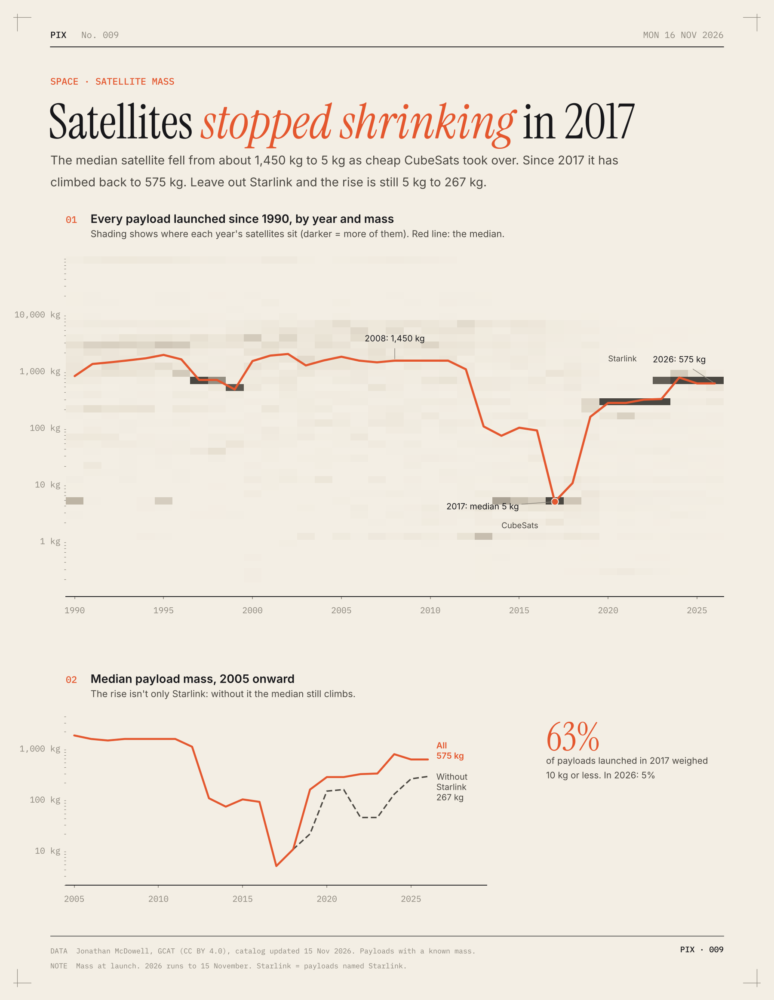
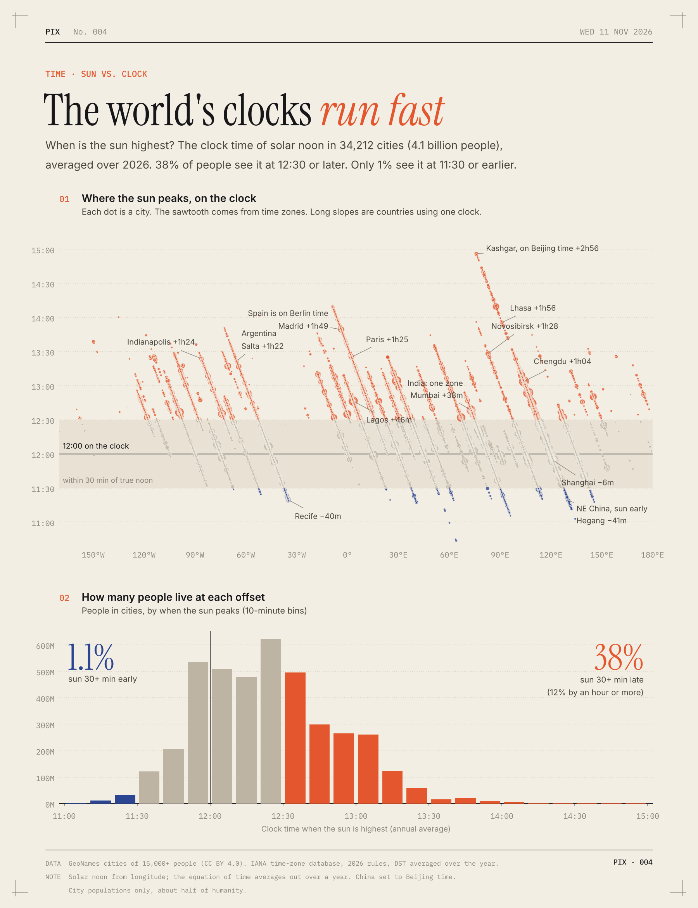
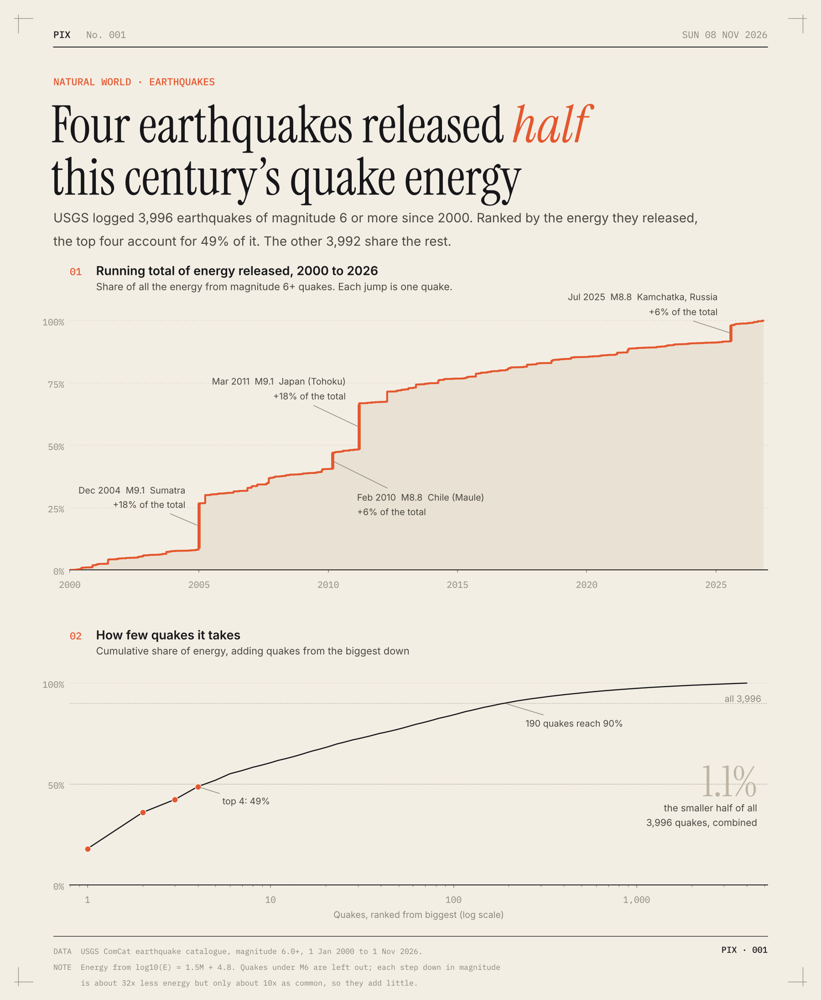

# pix archive

1 settled finding, newest first. Each folder holds the post, the chart, the evidence notes, the code and the data.

| Date | | Finding |
|---|---|---|
| 2026-11-18 |  | **[Older fathers pass on more new mutations](2026-11-18-older-fathers-new-mutations/post.md)** Genetics · Jónsson et al., Nature, 2017 Each year of a father's age at conception adds 1.51 new mutations to his child's genome. Each year of the mother's adds 0.37. |

## Earlier series

The first ten entries looked for new patterns in public data rather than charting settled findings. They are kept for the record.

| Date | | Analysis |
|---|---|---|
| 2026-11-17 |  | **[Israel is outgrowing its immigrants](2026-11-17-israel-outgrows-immigrants/post.md)** Migration The foreign-born share rose in 43 of 51 rich countries since 1990. Israel's fell the most, from 36% to 22%, even though 29% more immigrants live there now. |
| 2026-11-16 |  | **[Satellites stopped shrinking in 2017](2026-11-16-satellites-heavier-again/post.md)** Space The median satellite fell from about 1,450 kg to 5 kg by 2017 as CubeSats took over. It has since climbed back to 575 kg, and to 267 kg even without Starlink. |
| 2026-11-15 |  | **[By length, most new undersea cable has a Big Tech owner](2026-11-15-big-tech-long-cables/post.md)** Infrastructure Google, Meta, Amazon or Microsoft co-own 23% of the undersea cables due in service from 2025 to 2029, but 54% of the kilometres. Their cables are the long ones. |
| 2026-11-14 |  | **[Cocoa doubled its harvest by doubling its land](2026-11-14-cocoa-needs-new-land/post.md)** Food & land Since the late 1980s, 88% of the growth in world cocoa output came from new land. For coffee, the other big tropical tree crop, it was 18%. |
| 2026-11-13 |  | **[The move South explains only a third of lost basements](2026-11-13-basements-vanish-in-place/post.md)** Housing New US houses with a basement fell from 37% in 2000 to 16% in 2025. Building shifting South accounts for a third of that. Builders dropping basements in places that had them account for the rest. |
| 2026-11-12 |  | **[Most people alive were born after the Berlin Wall fell](2026-11-12-born-after-the-wall/post.md)** Demography 57% of the 8.3 billion people alive today were born after 9 November 1989. In Germany it's 37%, and in 101 countries it's under half. |
| 2026-11-11 |  | **[The world's clocks run fast](2026-11-11-clocks-run-fast/post.md)** Time For most people the sun peaks after noon, not at it. 38% see it at 12:30 or later. Only 1% see it at 11:30 or earlier. |
| 2026-11-10 |  | **[Two in five city dwellers live closer to a foreign capital](2026-11-10-closer-to-a-foreign-capital/post.md)** Borders For 39% of people in cities, some other country's capital is closer than their own. In China it's 68%, mostly because of Taipei. |
| 2026-11-09 |  | **[Last year the world added a South Korea of solar power](2026-11-09-solar-adds-a-country/post.md)** Energy New solar in 2025 made 636 TWh, about as much as South Korea's entire electricity output. In 2010 the new solar matched Kyrgyzstan. |
| 2026-11-08 |  | **[Four earthquakes released half this century's quake energy](2026-11-08-quake-energy/post.md)** Natural world Of 3,996 magnitude 6+ quakes since 2000, the top four released 49% of the energy. The smaller half of all those quakes released 1.1%. |
