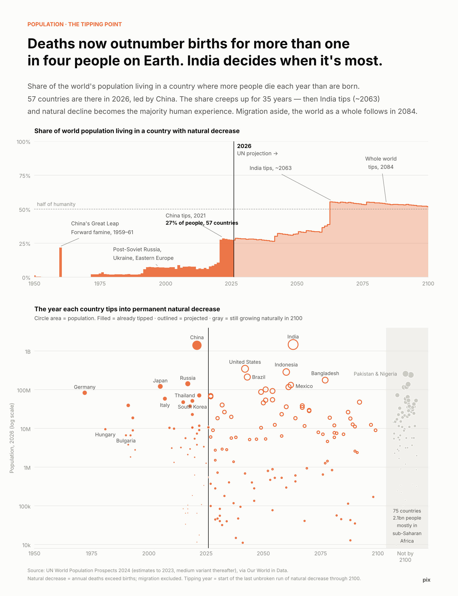

# pix archive

1 visual analyses, newest first. Each folder holds the post, the chart, the code and the data.

| Date | | Analysis |
|---|---|---|
| 2026-11-12 |  | **[Deaths now outnumber births for more than one in four people on Earth](2026-11-12-deaths-outnumber-births/post.md)** Population 57 countries, home to 27% of humanity, now record more deaths than births. The share barely moves until India tips around 2063, when it jumps 17 points in a single year. |
