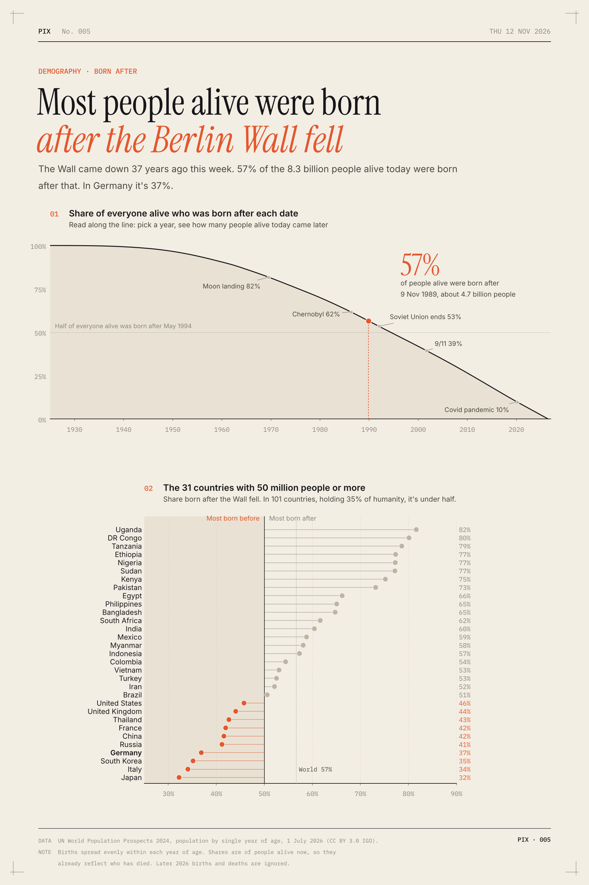
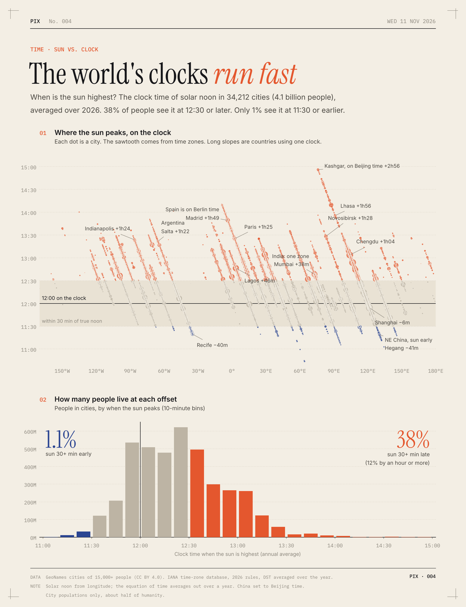
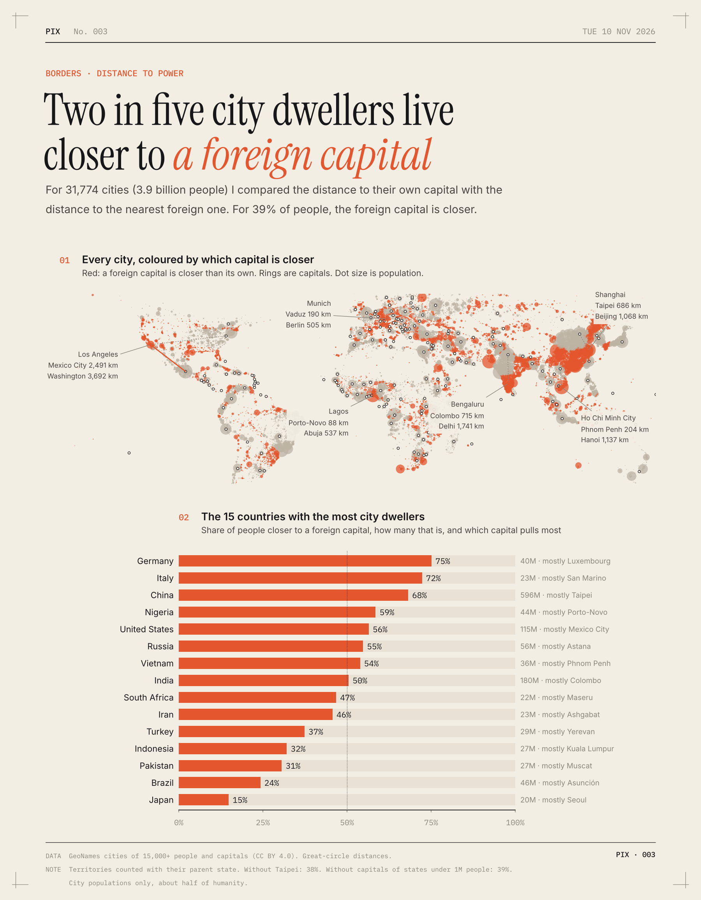
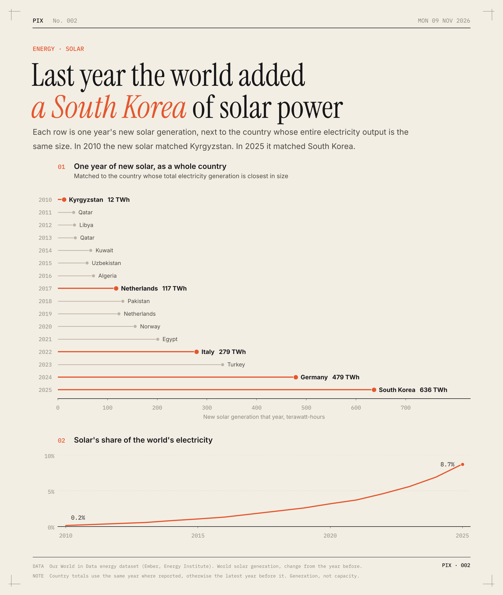
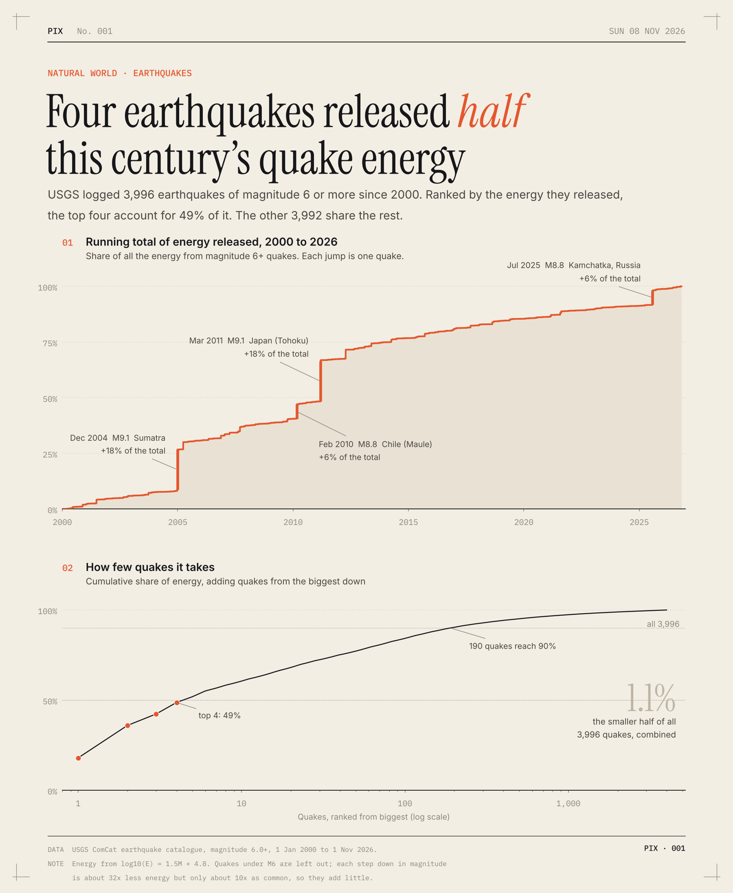

# pix archive

5 visual analyses, newest first. Each folder holds the post, the chart, the code and the data.

| Date | | Analysis |
|---|---|---|
| 2026-11-12 |  | **[Most people alive were born after the Berlin Wall fell](2026-11-12-born-after-the-wall/post.md)** Demography 57% of the 8.3 billion people alive today were born after 9 November 1989. In Germany it's 37%, and in 101 countries it's under half. |
| 2026-11-11 |  | **[The world's clocks run fast](2026-11-11-clocks-run-fast/post.md)** Time For most people the sun peaks after noon, not at it. 38% see it at 12:30 or later. Only 1% see it at 11:30 or earlier. |
| 2026-11-10 |  | **[Two in five city dwellers live closer to a foreign capital](2026-11-10-closer-to-a-foreign-capital/post.md)** Borders For 39% of people in cities, some other country's capital is closer than their own. In China it's 68%, mostly because of Taipei. |
| 2026-11-09 |  | **[Last year the world added a South Korea of solar power](2026-11-09-solar-adds-a-country/post.md)** Energy New solar in 2025 made 636 TWh, about as much as South Korea's entire electricity output. In 2010 the new solar matched Kyrgyzstan. |
| 2026-11-08 |  | **[Four earthquakes released half this century's quake energy](2026-11-08-quake-energy/post.md)** Natural world Of 3,996 magnitude 6+ quakes since 2000, the top four released 49% of the energy. The smaller half of all those quakes released 1.1%. |
